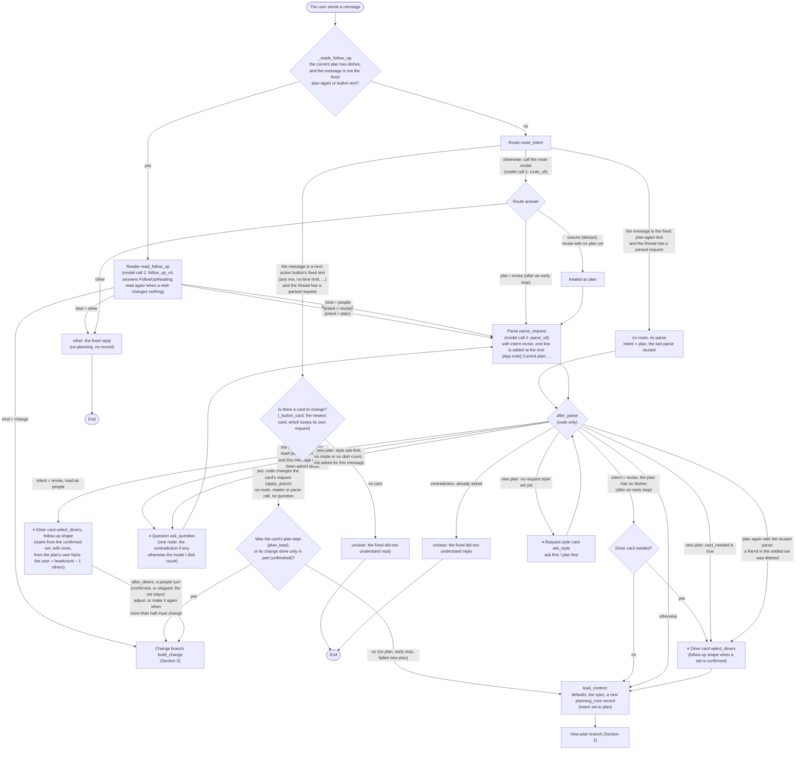
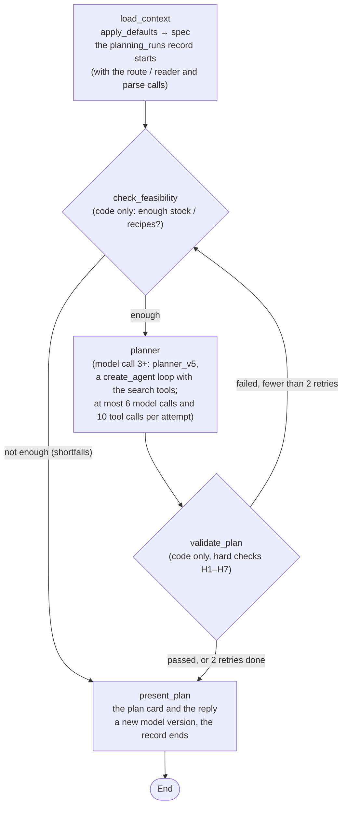
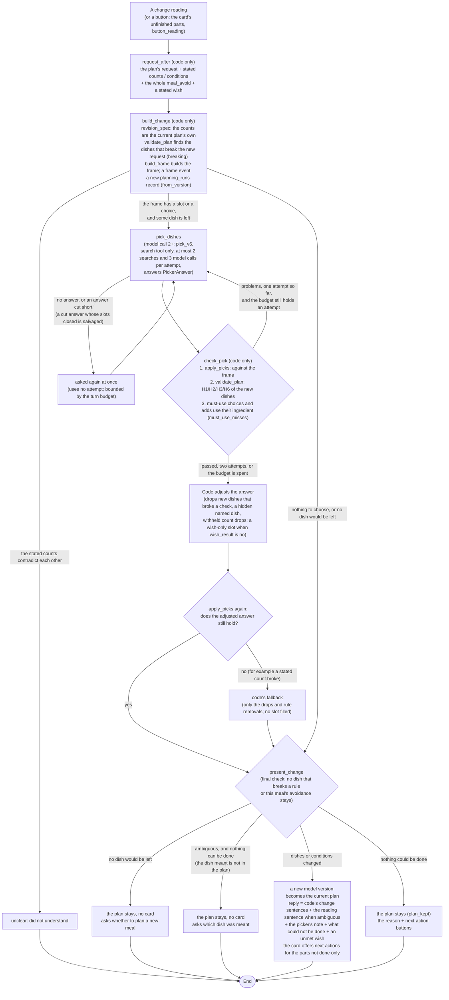

# The Planning Conversation: Route, Reader, New Plan, Change

This document follows one user message through the planning conversation: which node reads it, which model is called, what code decides, and what the user gets back. It is written from `backend/minemydinner/agent/graph.py` (`build_graph`) and the modules it calls. Related: `docs/planner-what-each-model-sees.md` (each model's full input), `docs/planner-request-and-counts.md` (the request and the counts), `docs/planner-shortlist-and-ranking.md`, `docs/planner-feasibility-check.md`, and `docs/planner-stock-rules.md`. The design is in `docs/superpowers/specs/2026-11-22-phase-1-plan-3b2-revise-simplification-design.md`.

**Whenever the conversation's flow changes, this document is updated in the same change.**

## How to read this document

The document describes the code **as of the Phase 1 plan 3b-2 change fixes**, including its final review fixes. Prompt versions: `route_v6`, `parse_v8`, `planner_v5`, `follow_up_v4`, `pick_v6` (`PROMPT_VERSIONS` in `backend/minemydinner/agent/request.py`).

Three labels separate what the code does now from what it did before:

| Label | Meaning |
|---|---|
| (no label) | **Current.** The code does this today, for every new conversation. |
| **[Compatibility]** | Current code that exists only for a thread, card or record saved by an earlier version. A new conversation never takes this path. |
| **[Earlier]** | No longer in the code. Kept only to explain where a current rule came from. All of these are collected in Section 5. |

A plan name in brackets, such as "(since 3b-1b)", says when a current rule arrived. It does not mean the rule is old.

The route, parse, planner, reader and picker all call models under one task: `planning` in the app, `planning_eval` in evaluation. Each task's configuration decides which model.

In the diagrams, boxes are LangGraph nodes (code names in brackets), diamonds are decisions, and a node marked ⏸ interrupts the conversation until the user answers a card (`interrupt`).

**The main idea of the current design:** a follow-up on a plan with dishes does not go through the route. The reader (`read_follow_up`) reads it once and answers what the message wants. On a change, code works out which dishes change (the frame, `build_change`), and the picker (`pick_dishes`) only chooses dishes for the slots the frame leaves. Code checks every answer. A change turn makes at most seven model calls.

---

## 1. The whole flow

### What each decision rests on

| Decision | Condition (code) | Why |
|---|---|---|
| Reader, not route | `_reads_follow_up`: the current plan has dishes (`_has_dishes`), the last message is a typed user message, and it is neither the plan-again text nor a button's text | Spec 5.1: a follow-up is read once, by a reader that sees the plan, the conditions, the diners' rules and the whole conversation together |
| Read again | `reading_changes_nothing`: a `change` reading with a wish, but no `remove`, `add`, `wish_targets`, stated count or condition, and a `meal_avoid` equal to the plan's | Code checks the structure, not the words. The second reading is used whatever it says. A reading with no wish is never read again, so the which-dish question is untouched. The re-read takes one call from the picker's turn budget |
| The reading's path | `after_reading`: `change` → `build_change`; `new_meal`, `people` → the parse; `other` → the fixed reply | `READING_INTENTS`: change and people are recorded as intent revise, new_meal as plan |
| No route (plan again) | `_reuses_parse`: the last message is exactly the fixed plan-again text and `state.request` is set | Plan again reuses the newest parse and saves two model calls |
| No route (next-action button) | `_is_action_message`: the last message is exactly one of the five buttons' fixed texts (`ACTION_MESSAGES`, both languages; a test keeps them equal to the frontend's) and `state.request` is set | Code knows what a button changes |
| No parse for a button either (since 3b-1b) | `_button_card`: the newest reply's card keeps the `request` it was built from. Code changes one field (`apply_action` in `agent/actions.py`: allow shopping → shopping; fewer dishes → the total down by one, never below one; no time limit → the limit cleared; any mix → the sides cleared, the total kept (`relax_split`; a typed `any_mix` starts from the same request, `any_mix_request` in `agent/change_step.py`); named ingredients optional → `must_use` and `all_use` moved into `prefer_use`). A card with `plan_kept` (the plan stayed) or `unfinished` (the change was done only in part) goes to the change branch; any other card plans from scratch. A button pressed with no card to change gets the fixed unclear reply, with no model call | The button keeps that turn's other conditions. On a card whose plan was kept or changed in part, it keeps the hand edits and re-runs only the parts not done. The record carries `request["button"]` |
| unsure becomes plan | The route answers `unsure` | A message on a plan with dishes never reaches the route, so when the route runs there is no dish to change. (**[Earlier]** an unsure answer showed a revise-or-plan choice card, Section 5) |
| revise becomes plan | `current_plan` is empty | There is no plan to change. A no-plan or early-stop reply counts as "a plan with no dishes": a route answer revise parses the message as a follow-up and plans from scratch |
| Contradiction question | `request_problem`: the meat and vegetable ranges do not fit the total, or the total is over the limit | Asked in every style, at most once per new message. On the change branch, contradicting stated counts get the did-not-understand reply (no question) |
| No ask-first question with intent revise | `_revises(state)` is true | Unstated fields come from the current plan (`carry_unstated`), not from the defaults |
| Diner card | New plan: `card_needed` (table below). A `people` reading always shows it. Plan again with the reused parse ignores `card_needed` and checks only whether a friend in the settled set was deleted (`friend_deleted_since`). With a confirmed set, or on a `people` turn, the card takes its follow-up shape (`build_follow_up_card`): it starts from the confirmed set (on a thread with none, from the plan's facts, `settled_from_plan`), and its total from the headcount the parse states (`parsed_headcount`, before `carry_unstated`) | A change in who eats must be confirmed by the user, never made quietly; plan again reuses the people already confirmed; nobody leaves the set without the user's own act |
| After the card | `after_diners`: a `people` reading on a plan with dishes → `build_change` (the plan is adjusted, never planned anew); anything else → `load_context` | Plan 3b-2 (two) spec 5.1: hand edits and locked dishes survive a change in who eats |
| Order of the checks | contradiction → intent revise (people shows the card / the card check when there are no dishes) → request style → ask-first question → diner card → `load_context` | Intent revise comes before the request style, so a follow-up never shows the request-style card |
| Request-style card | No `request_style` in the database yet | Asked once; skipped means plan first |
| Ask-first question | Style `ask_first`, and `mode` is empty or no dish count was stated; not yet asked for this request | design 6.2 |

### When the diner card shows (`agent/diners.py: card_needed`)

| Situation | The card shows when |
|---|---|
| Any time | The user states a new rule of their own |
| No settled diner set yet | The user states a diet word about themselves ("吃素"); or the headcount is 2 or more, someone else is mentioned, the parse finds a guest, a saved friend is recognised, or someone else's rule is stated |
| A settled set exists | A friend in the set was deleted; a friend or guest outside the set appears; a rule the set lacks is stated; the set has others but this parse says the user eats alone; the parsed headcount differs from the confirmed one |
| A follow-up on a plan with dishes | The reader reads `people` (a change in who eats, or a lasting rule about someone): the card shows in its follow-up shape, then the current plan is adjusted on the change branch (Section 3, "A people turn"). A skipped card keeps the confirmed set; the reading's other changes still run |

### The follow-up diner card (since 3b-2 (two))

`build_follow_up_card` (`agent/diners.py`); the frontend is `DinerCard.tsx`.
- **Start**: the confirmed set. Every diner of the set who still exists is selected, plus the friends the message names. The set's meal-only rules are proposed for this meal (ticked, "save" off). The set's guests come first and keep their keys; confirming (`apply_answer(settled=)`) keeps their keys and labels, and never trusts a key the set did not issue.
- **No confirmed set**: it starts from the plan's own facts (`settled_from_plan`): the user, the plan's headcount minus one as unmatched people (`unsure` when the plan had unconfirmed diners, otherwise `none`), no meal-only rules, no guests.
- **The total**:
  - when the message states a headcount (`parsed_headcount`), that number, never below the people preselected. When the stated number is below, the card shows a notice (`stated_total`) and code unticks nobody;
  - otherwise the set's headcount plus the people the message adds (new guests and newly matched friends).
- **Unnamed people in the message**:
  - one with a stated rule (allergy, avoid item or diet word) is always listed as a new guest, so the rule is never lost;
  - one with no rule is covered by the set's unnamed people first (unnamed guests and unmatched people), and is a new guest only beyond them.
- **Frontend, follow-up card only** (the card carries `others_answer`, even when null):
  - unticking a person or removing a guest lowers the total by one; ticking back or adding one guest raises it by one;
  - "fill in" on the unmatched people turns them into named guests and keeps the total.
  - The first-turn card is unchanged: its total only rises to fit the people ticked and added.
- **Invariant**: confirming the card untouched gives back the set plus exactly what the message added.

**One-meal avoidance**: words about this meal only ("今天不想吃土豆") are nobody's lasting rule and show no card.
- First turn: the parse puts it in `meal_avoid` (`parse_v8`).
- Follow-up: the reader gives this meal's **whole** `meal_avoid` list after the message, so "香菜其实放点也行" takes 香菜 off the list and the avoidance is withdrawn.
- It is this meal's own rule (diner key `meal`, `with_meal_avoid`) and goes into no profile; words like "肉" and "海鲜" cover the dictionary's whole category.
- Taste words ("这顿不要辣的", "豆腐有点多") are a wish (`wish` / `query`), not an avoidance; a lasting rule ("我先生以后都不吃羊肉") is read as `people`.
- Code replaces a dish that breaks the avoidance, so the reader lists it as `drop` only when the message says not to replace it (`follow_up_v4`).

The plan card keeps `meal_avoid` for later turns.

---

## 2. The new-plan branch (planning from scratch)

- First attempt: the opening message is the shortlist plus the request summary ("Plan this meal.").
- Retry: one more message lists every violation of the last attempt and its dishes.
- At most 1 attempt plus 2 retries, so 3 attempts.
- When an attempt gives no answer (a call limit or the token budget): code fills the counts with usable dishes in shortlist order (`fallback_ids`) and checks them as usual; a fallback that passes does not count as a first pass.
- A taste wish that cannot be met (`planner_v5`): the planner plans by the other conditions and answers `wish_met: false`; the reply starts with the fixed sentence "菜谱库里没有符合“…”的菜，先按其他要求给你配了这份。", and the card adds "import more recipes" ("allow shopping" too in fridge-only mode).
- When every attempt fails: the closest attempt without H2 or H5 is shown (an empty one never counts) under a fixed opening. When every attempt has H2 or H5, no dishes are shown, only the reason and the next-action buttons (blocked only by a one-meal avoidance, the reason says the library has too few dishes without it). When every attempt was empty, the reply says no dishes could be put together for this request, never "0 dishes".
- When the feasibility check falls short: no model call; the reason and the next-action buttons ("allow shopping", "any mix", "named ingredients optional").

### Hard checks (`planning/validate.py`)

| Code | Meaning | New plan | Change |
|---|---|---|---|
| H1 | Missing ingredients in fridge-only mode | Fails | Frame: an unlocked dish that breaks it becomes a replace slot. Picker: a new dish that breaks it is sent back |
| H2 | Breaks a diner's avoidance or allergy, or this meal's one-meal avoidance (not covered by a confirmed keep) | Fails, and such a plan is not shown | Frame: the dish (locked ones too) becomes a replace slot and is removed when nothing replaces it. Picker: a new dish that breaks it is sent back. Final check: such a dish never stays in the result (Section 3) |
| H3 | Missing cookware | Fails | As H1 |
| H4 | Wrong dish count or meat/vegetable split | Fails | Not the model's job: with no stated count the change list sets the counts (the result card is checked with `result_spec`); with a stated count the frame adds slots or drops dishes to meet it |
| H5 | A dish that does not exist, or a duplicate | Fails, and is not shown | Picker: an id not in the library, already in the plan, or chosen twice is sent back (`apply_picks`) |
| H6 | Over the time limit | Fails | As H1 |
| H7 | A named ingredient not used | Fails | Frame: a new must-use ingredient no dish uses gets a "replace 1" choice for the picker (an add slot carries it when there is one). Picker: a new dish that does not use it is sent back; when it still does not, the original dish stays (or the add is not made) and the reply says once that it was not used |

---

## 3. The change branch

### How it differs from the new-plan branch

**Shared:**
- the same model loop (`create_agent`) and search tool (the picker has only `search_recipes`);
- the same shortlist builder (the picker gets only its slots' dish types, without the plan's dishes);
- the same hard checks (`validate_plan`).

| | New plan | Change |
|---|---|---|
| Who reads the user's words | Route + parse | The reader, once (at most once more when nothing changes) |
| Where the counts come from | The parse + defaults | The current plan's own counts, moved by the change list's drops, replacements and adds; a stated count wins |
| Who decides what changes | The planner chooses the whole menu | Code (the frame); the picker only fills slots and picks within bounded choices |
| The model's answer | The whole menu (`PlanProposal`, with `wish_met`) | A dish or 0 per slot, the dishes per choice, `note`, `wish_result` (`PickerAnswer`, no nullable field) |
| Retries | At most 2 | At most 1; an empty or cut reply is asked again apart, at most 6 picker calls a turn |
| The reply | The model's note (code speaks first when a wish is unmet) | Code writes "去掉了… / 把A换成了B / 加了…" (one more sentence when a locked dish changes), the reader's sentence when ambiguous, then the picker's note |
| On failure | The closest attempt, or only the reason | What can be done is done; when nothing can, the plan stays |

### What the reader sees

One user message, in up to six parts:
- `Current plan:` one line per dish, `id title (type; main ingredients)`, then the marks `LOCKED` / `LOCKED KEPT CONFLICT` / `OPEN CONFLICT`, and `BREAKS THIS MEAL'S WISH` for a dish that breaks this meal's current avoidance;
- only when the user changed the plan by hand after it was proposed: one line, `The user changed this plan by hand after it was proposed: added ...; removed ....` (by title, in order; hand edits add no message, so the reader is told);
- `Diners:` the confirmed diners' anonymous rules (Diner 1 is the user), or `- no diner rules`;
- `Current conditions:` headcount, the counts the user stated, mode, time limit, must use, prefer using, leave out of this meal, taste wish;
- `Conversation:` the whole thread, one `User:` / `Assistant:` line per message;
- `Reply locale:`.

No recipe library, no shortlist, no tools. A full example is in `docs/planner-what-each-model-sees.md`.

When it is asked again, the same messages get one more user message with the problem: `Your reading says "...", but it changes no dish: say which dish goes (remove) or what is added (add) for the wish. Answer again with the whole reading.`

### The reader's answer (`FollowUpReading`)

| Field | Meaning |
|---|---|
| `kind` | `change` (change this plan) / `new_meal` (a different meal) / `people` (a change in who eats, or a lasting rule about someone) / `other` (not about this meal's plan) |
| `ambiguous` / `reading` | Whether the message is ambiguous; one sentence on how it was read, shown only when ambiguous |
| `remove` | Dishes to remove: each an id, a `mode` (`drop`: just not wanted, the plan gets smaller; `replace`: another dish in its place), the `quote` of the user's words that point at it, and for a replace the dish the user named, `with_name`; `for_wish` when it is replaced only to meet the wish |
| `add` | Dishes to add: a dish type (null: any type) and a count, or a dish the user named, `name`; `for_wish` when it is added only to meet the wish |
| `wish` / `wish_targets` | The taste wish in the user's words; `wish_targets` lists only the plan's dishes the wish is about, most touched first, and is empty when the wish only guides a dish the message removes or adds; a wish for something the plan lacks ("想吃点水产") becomes an add or a replace, never a wish alone |
| `meal_avoid` | This meal's **whole** list of things to leave out after the message |
| `counts` | Only the counts the message states, absolute for the whole plan ("少一个菜" is written as the number it gives on the plan shown) |
| `conditions` | The stated mode, time limit (or its clearing), must use, prefer use |

The reading never holds new dishes (the picker's job) or the final counts (code's job). Each request is applied once: a dish in `remove` is never also in `wish_targets`.

### How code builds the frame (`agent/frame.py: build_frame`)

In order. The last column names the **[Earlier]** after-the-fact check of the 3b-1 / 3b-1b revise step that the step took over (Section 5); it is history, not current behaviour.

| Step | What it does now | [Earlier] check it took over |
|---|---|---|
| 1. Named removals | `drop` removes the dish; `replace` makes a replace slot with no dish type; a named replacement that equals a library title and is usable is placed directly, any other name makes a named slot for the picker. A locked dish needs a quote, and the quote need only be in this message (whether it points at the dish is the reader's judgement), otherwise it is refused (`locked_without_quote`) | R1, R2, R3 |
| 2. Dishes that break the new request | A diner rule, this meal's avoidance, stock in fridge-only mode, cookware, the time limit: each becomes a replace slot with no dish type. A locked dish is replaced only for a rule or the avoidance; stock, cookware and time never move a locked dish. A dish the reading itself drops gets no slot and just goes | "A dish with a red conflict or breaking the one-meal avoidance must be replaced" |
| 3. The wish's targets | Each of the reader's `wish_targets` becomes a replace slot for the wish, unlocked dishes only, at most half of them (rounded up, at least 1), in the reader's order; a removal the reader marked `for_wish` (a dish replaced only for the wish) counts toward that limit first and is itself never capped; a locked target, an id not in the plan and one over the limit go to `ignored`, and the locked and over-the-limit ones also to `locked_wish_targets` and `capped_wish_targets`. A wish that touches no dish and guides no new dish changes nothing, and the reply says so; when every target is locked the reply says they stay, and when some targets are over the limit it says once that a wish changes at most half of the dishes at a time and the user can ask again (it states the cap's effect, it does not judge the wish) | R4 |
| 4. Adds | A named dish: placed when it equals a library title and is usable, recorded missing when a hard condition hides it (over the time limit, breaks a rule); any other name makes a named add slot the picker searches for, and only when it finds nothing is the dish said to be not in the library. A typed add: one add slot per dish. An add with no type ("再添两道"): one slot per dish, a meat or a vegetable dish the picker chooses (it counts toward a stated total, not toward either side; code rejects any other type) | R8 |
| 5. Counts | No stated count: the change list sets them (a replace slot counts as its dish's type). Stated counts: only the stated fields bind; they are recorded in `count_ranges` and checked on the picker's result; above the plan code adds slots, below it drops first new dishes not yet chosen, then unlocked dishes (a "drop exactly N" choice for the picker when there are more candidates than needed) | R7, `attempt_spec` |
| 6. A new must-use ingredient no dish uses | The picker replaces 1 of the unlocked dishes, the choice naming the ingredient; an add slot carries it instead when there is one (the first add for a stated count, else the first add) | — |
| 7. Is any dish left | If not, it asks whether to plan a new meal, with no picker call | R9 |

Finding a named dish (`lookup_named`): only a title equal to the name (case and spaces ignored). Anything else (one character off, part of a title) is the picker's judgement of which dish the words mean; when the dish it finds is hidden by a hard condition, the reply gives the real reason, never "not in the library".

### What the picker sees

One user message:
- The shortlist: an add gets its own dish type; a replace slot, a replace choice and an add of any type take any type, so they get the replaced dishes' types plus meat and vegetable dishes. Each candidate also lists its main ingredients (`main`, right after `title`; the planner's shortlist has none). It is built from the new request, and the plan's dishes and the dishes placed by name are left out (the picker may not choose them). With only a drop choice: "Shortlist: none given...".
- `Current plan:` with its marks (computed against the new avoidance).
- `Diner and meal rules:` the diners' anonymous rules, plus "This meal only, not a diner's rule: leave out ...".
- `Meal conditions:` one line with the mode, the time limit and the must-use ingredients (on every call).
- `Stated counts (code checks the result):` only when counts were stated: each stated field with the plan's number after what code already decided, and the stated number; the total is written "dishes (meat and vegetable dishes, soups not included)", so a soup never counts as a dish.
- `The user's wish:` the reading's wish. On a button turn it is the wish of the structured reading kept on the offering card, never that turn's words, which could contradict the button.
- `Already decided:` dishes leaving, dishes placed by name.
- `Choices (which current dishes go):` one line each (drop exactly N / replace 1 to N; a must-use choice says "the new dish must use ...").
- `Slots (new dishes to choose):` one line each (a replace slot names its dish and says the user's words are why it goes, not a guide to its replacement (a named slot keeps the name instead), with "for the wish" when it is; an add says "one more <type> the user asked for", "one more meat or vegetable dish the user asked for, either kind" for an add with no type, or "one more dish ..., of any type" for a named add; a named slot gives the user's name, asks for the library dish these words mean "by its title or by its main ingredients", and "or 0 when none is"; an add carrying a must-use ingredient says "it must use ...").
- `Reply locale:`.

It never sees the conversation, the reading, or the rest of the request summary (unstated counts, prefer use, all use).

The retry message: `Your previous answer had these problems. Answer again with each one fixed:` and one line per problem (a choice answered wrongly, a typed add of the wrong type, an add with no type filled with a dish that is no meat or vegetable dish ("Slot <n> must be a meat or vegetable dish."), a stated count broken, a dish already in the plan, a new dish that breaks a rule / misses stock / misses cookware / is over time, a dish chosen for a must-use ingredient that does not use it).

Asked again with no answer: `You gave no answer. Answer with the PickerAnswer tool.`; with an answer cut short: `Your answer was cut short before it ended. Answer again in full with the PickerAnswer tool.`. This uses no attempt but counts toward the turn budget (`PICK_TURN_MODEL_CALLS` = 6, one less when the reader was asked again and less the turn's model calls that are not the reader's (`earlier_calls`: the parse on a people turn, none on a change turn)); an attempt or re-ask starts only when a whole attempt (3 calls) still fits, otherwise the last answer stands, and with none code's fallback takes over.

### The picker's answer (`PickerAnswer`, `pick_v6`)

No nullable field, in this order:

| Field | Meaning |
|---|---|
| `choices` | The ids chosen per choice (exactly N for a drop choice; 1 to N for a replace choice, each chosen dish getting a slot for its replacement after the listed ones) |
| `slots` | A recipe id per slot, 0 when nothing fits, with a short reason |
| `note` | One or two sentences, in the reply locale, on why the new dishes fit |
| `wish_result` | `"yes"` / `"no"` / `"no_wish"`: whether the new dishes chosen meet the wish (since `pick_v5`, "yes" even when not every dish the wish touches could change; "no" when the dishes chosen for the wish do not meet it or nothing could be chosen for it); `"no_wish"` when there is none |

Code converts it at the boundary (`PickerAnswer.picks()`): 0 becomes None, and `wish_result` becomes the internal `wish_met` (true / false / None), which the records and the reply use. Why: DeepSeek cut some answers right after the key of a nullable field (server-side, HTTP 200); with no nullable field and this order, no answer was cut in the latest runs. An answer cut after its `choices` and `slots` closed is salvaged (`salvaged_picks`; `salvaged` true on the event) and checked as usual; when its `wish_met` is unknown but it chose a dish for a slot made only for the wish, it is set aside as no answer and asked again.

### How code adjusts and re-checks the picker's answer

After the last attempt, code may change the picker's answer before using it:
- a new dish that broke a check is left out (its slot is unfilled);
- a named dish that a hard condition hides is left out;
- an add made for a stated count that found nothing withholds the drops made with it (the plan never shrinks unasked);
- when the picker says the wish is not met (`wish_result` `"no"`), a slot made only for the wish stays unfilled (`without_unmet_wish_picks`).

When any of these happened, code applies the adjusted answer to the frame again (`apply_picks`). If that second result has a problem (for example, two crossed-type picks of which one was left out break a stated count), code drops the adjusted answer and uses its fallback instead (`fallback_pick`): the drops and the rule removals are made, no slot is filled, and the reply speaks as for any fallback ("this time").

Then `present_change` makes one final check: a dish that breaks a diner rule or this meal's avoidance (`RULE_BREAKS`) is taken out of the result, unless the turn asks the empty-plan question. So such a dish can never stay, whatever happened before. A dish counts as replaced only when its new dish is really in the result.

Known gap (in `docs/phase-1-carryover.md`): when only this final check removes a dish, the `change_outcome` record's `slots` may still name it; the reply and the card are right.

### When the change cannot all be done

- An unfilled replace slot keeps its dish; but a slot made because the dish breaks a diner rule or the one-meal avoidance (`breaks_rule`) **removes** the dish when nothing replaces it, and the reply says no replacement was found.
- When the picker says the wish is not met, a slot made only for the wish (a wish target, or an add or replace the reader marked `for_wish`) stays unfilled: the dish stays, the add adds nothing, and the reply says the wish was not met. Every other slot keeps the picker's dish (user decision, 2026-11-23).
- Code's fallback (no usable picker answer, or an adjusted answer that failed its re-check): a dish that breaks a rule still leaves, and the reply says no replacement could be chosen this time; an unfilled add or replace says it could not be done this time ("这次没能…，可以再试一次"), never "nothing found"; nothing is said about the wish, since nothing was tried.
- A dish the reading itself drops leaves, and the reply says it was removed ("去掉了…"), never that nothing could replace it.
- An add made for a stated count that finds nothing: the drops made with it are withheld.
- A named dish not in the library (the picker answered 0), or hidden by the time limit or another condition: not added, and the reply gives the reason (over time says how long it takes).
- A new must-use ingredient no dish uses: the original dish stays (or the add is not made); only when the result really misses it does the reply say so once ("没找到用豆腐做的菜来换红烧茄子，这次没用上豆腐，红烧茄子先留着。"). The name leaves the new version's spec and `plan_request` (so the card shows no second H7), but this turn's `request` keeps it, so a button tries again.
- The reply lists what could not be done, and the card offers next actions for those parts only (import recipes, no time limit, allow shopping, ...). A typed meat or vegetable add left unfilled also offers "any mix", whether or not the turn stated a count: pressed, it keeps the total that turn asked for and re-runs those adds as dishes of any type. When the turn stated no count, the total is the plan shown plus the typed meat and vegetable adds it could not make; when it stated counts, the stated total plus the adds on a stated side (`side_adds_left`). The card's `unfinished` keeps the parts not done and this turn's structured reading; a button on that card re-runs only those parts.
- Wish targets over the limit (half of the unlocked dishes, rounded up) stay, and the reply says so once, after the change sentences and before the picker's note: "一次最多为愿望换一半的菜，其余的先留着；还想换的话可以再说。" ("A wish changes at most half of the dishes at a time, so the rest stay; ask again to change more.").
- Nothing could be done: the plan stays (`plan_kept`).

### Counts after a change (`revision_spec` + the frame)

- The baseline is the current plan's own dish count and split, hand edits included, all exact.
- The reading states counts (`request_after` sets `counts_stated_now` true, "stated this turn"): the stated counts replace the whole count group of the old request, and bind even when they equal the earlier request.
- No stated count: the message changes no count; the plan's counts move with the change list: a drop shrinks it, a replace keeps it, an add grows it.
- A change that leaves no dish ("全都不要了"): nothing changes, and the reply asks whether to plan a new meal.
- Mode, time and named ingredients change only when the reading states them; an unmentioned one is never cleared (clearing the time limit takes an explicit `clear_time_limit`). The one-meal avoidance is the reading's whole list, so it can be withdrawn.

### A people turn: adjust, or make it again (since 3b-2 (two))

After the diner card of a `people` reading, `build_change` runs on the current plan:
- **Constraints:** from the newly confirmed set (`people_constraints`), with this meal's avoidance as usual; after a skipped card, the old ones. `old` is the plan's headcount, `new` the set's.
- **Counts the headcount moves** (`moved_counts`): the plan's dishes move by the change in the default composition's dishes (1 → 1+0, 2 → 2+0, 3–4 → 2+1, 5+ → 3+1), never below 1, and its soups by the change in soups, never below 0. They are put on the reading as its stated counts before `request_after`, so they bind like counts the message states; a rise in the dishes is also put on the reading as untyped adds (a meat or a vegetable dish of the picker's choice), which the frame takes out of the side total, so no typed side add is made. When the message states its own counts (any `add` or any stated count, `message_sets_counts`), the difference is not applied at all. Equal defaults (3 → 4 people) move nothing.
- **The request** takes the new headcount.
- **Must change** (`must_change`): the dishes that break a rule of the new set (locked dishes included) plus those the moved counts drop. When more than half of the plan's dishes must change (`remakes`) and some dish is unlocked, the plan is **made again**: `build_frame(remake=True)` turns every unlocked dish into a replace slot, and a locked dish that breaks no rule stays. Otherwise the frame **adjusts**: rule breakers become replace slots, and the moved counts add or drop dishes as on any stated count. With every dish locked a remake would change nothing, so none is claimed.
- **The plan stays** only as on any change; even then the new constraints stay and `plan_request` takes the new headcount. When the confirmed set changed (`diners_changed`), the same dishes make a new version, so the card's diners line shows the new set.
- **The reply** leads with the who-eats sentence ("现在是 4 个人吃。"). When the moved counts would drop dishes that are all locked, the reply says they stay and the count did not drop.
- `change["diner_change"]` keeps `old_headcount`, `new_headcount`, `present` (the plan's counts), `moved`, `must_change`, `remade` and `skipped`; it is None on any other turn.

### Locked dishes and versions

- **Locked dishes** = dishes added by hand (`locked`) + dishes with a confirmed keep. A dish with a red unconfirmed conflict is not locked, and is replaced (removed when nothing replaces it).
- A locked dish is never a candidate of a choice; it leaves only when the user's words point at it, or when it breaks a rule or this meal's avoidance.
- A change makes a new **model version** (`edited: False`) carrying the locked dishes and confirmed conflicts that stay. A change of conditions with the same dishes is a new version too (for example, only the mode changed).
  - A typed any-mix reading (`any_mix`) that lifts the plan's meat/vegetable split is such a change even when no dish changes: the new version keeps the same dishes and has the split cleared in its spec and `plan_request` (`present_change`, `lifted_split`).
- "Restore the model's plan" restores the newest model version, a change's version included, with its locks and confirmations.
- When the plan stays: `current_plan` and the version list do not change; `request` keeps this turn's request, so a later plan again uses the newest request. The reply's card carries this turn's request and `plan_kept`, so a next-action button on it changes the current plan again.

### Records

Every change turn is a planning run: the request holds `reading` (`button` on a button turn) and `revision.from_version`. Its events, in order:
- the reader's `model_call` (step `read_follow_up`; two when it is asked again, with a `reader_reask` event between them keeping the problem and the first reading);
- on a people turn, the parse's `model_call` (step `parse`), then `diner_change` (the keys of `change["diner_change"]`);
- `frame` (the reading used, the breaking dishes, the must-use names no dish uses, the frame);
- one `pick_attempt` per picker attempt (the answer in code's form, its problems, `empty_replies`, `salvaged`, `salvage_set_aside`); a tool call whose arguments could not be read is kept on the `model_call` event as `invalid_tool_calls`;
- `change_outcome`.

The tools version is `PICK_TOOLS_VERSION`.

---

## 4. Model calls per message

| Path | Calls |
|---|---|
| A first message, a message after an early stop | route 1 + parse 1 + the planner's 1–6 per attempt (search round trips included), at most 3 attempts; a route answer other: route 1 only |
| On a plan with dishes, read as other | reader 1 |
| On a plan with dishes, read as change | reader 1 + the picker when needed, 1–3 per attempt, at most 2 attempts, re-asks included, at most 6 picker calls a turn; when the reader is asked again, reader 2 + at most 5 picker calls. So at most 7. Usually 2 in all; 1 when no new dish and no choice of which dishes go is needed (a stated lower count with more candidates than dishes to drop calls the picker even with no new dish). Evaluation round 11: 2.1–2.3 on average, 4 at most |
| On a plan with dishes, read as people | reader 1 (2 when asked again) + parse 1 + the picker when needed, from the same budget of 6 less the parse (and a reader re-ask). So at most 7 |
| On a plan with dishes, read as new_meal | reader 1 (2 when asked again) + parse 1 + the planner's calls per attempt, at most 3 attempts |
| Plan again | the planner's calls per attempt |
| A next-action button on a card that keeps its request | no route, reader or parse call; the picker when needed on a card whose plan was kept or changed in part (at most 6), the planner per attempt on any other card |

---

## 5. [Earlier] The 3b-1 / 3b-1b revise flow, and what replaced it

None of this is in the code any more. Its prompt files (`revise_v1` – `revise_v4`, older `route_*` and `parse_*` versions) stay in `backend/minemydinner/agent/prompts/` as frozen records of past runs.

In 3b-1 and 3b-1b a follow-up went through three models: the route (`route_v3` → `route_v6`, answering plan / revise / unsure / other), the parse (with the app note), and the revise step (`revise_v1` → `revise_v4`, answering a change list, `RevisionProposal`, which code checked after the fact with rules R1–R9 and sent back at most 2 times). A route answer unsure showed a revise-or-plan choice card. Most misses of evaluation rounds 9 and 10 fell on the boundaries where the three models read the same message differently (`docs/planning-evaluation-history.md`).

| Topic | Earlier (3b-1 / 3b-1b) | Now (3b-2 (one)) |
|---|---|---|
| Who reads a follow-up on a plan with dishes | Route, then parse, then the revise step | The reader, once |
| Unsure route answer | Revise-or-plan choice card | Treated as plan (a plan with dishes never reaches the route) |
| Who decides which dishes change | The revise model's change list | Code's frame (`build_frame`) |
| How rules are enforced | R1–R9 checked the change list afterwards and sent it back | The frame steps build the rules in (table in Section 3); the picker's answer is checked by `apply_picks`, `validate_plan` and `must_use_misses` |
| What the model answers | The whole change list (`RevisionProposal`) | A dish or 0 per slot and the bounded choices (`PickerAnswer`) |
| Calls per change turn | Route 1 + parse 1 + the revise step per attempt, up to 3 attempts | At most 7 in all, usually 2 |

**[Compatibility]** leftovers of that flow still in the code:
- an old thread's history may hold an answered choice card; the chat page still shows it as one history line ("You chose: Change this plan", or "Skipped"), and the backend gives it no question text;
- the modules once named `agent/revise_step.py` and `agent/revision.py` are now `agent/change_text.py` (the change reply's sentences) and `agent/change_rules.py` (the spec, carry-over and limit rules).
